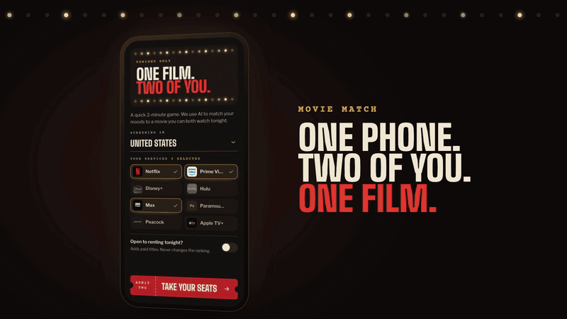
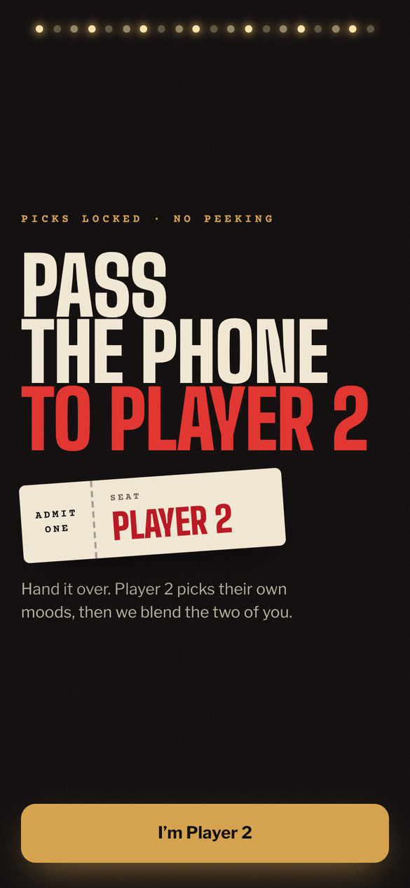
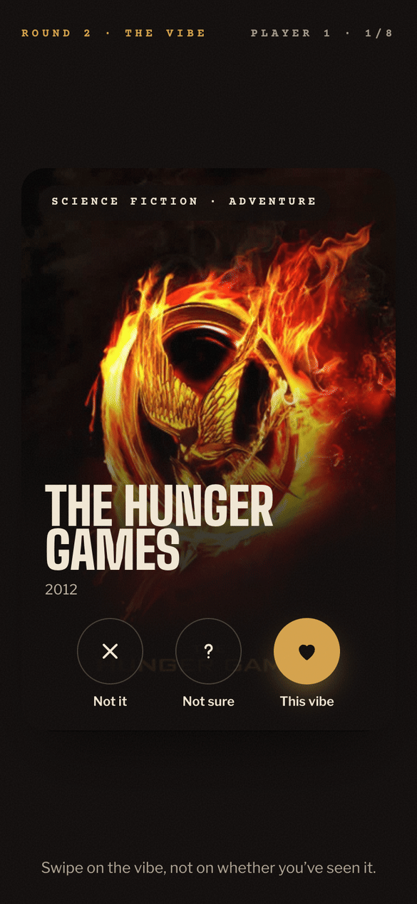
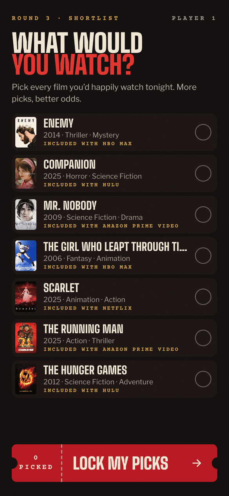
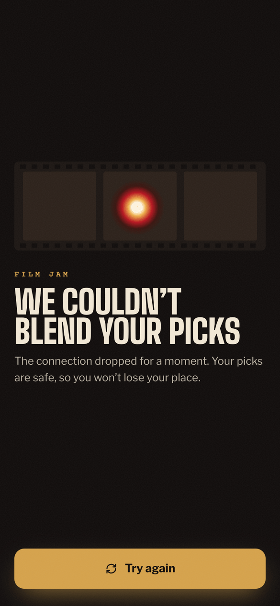

# Movie Match

**A short game for two people on one phone that ends on a film you both picked, on a service you already have, tonight.**

<p align="center">
  <a href="docs/media/movie-match-full-game.mp4"></a>
</p>
<p align="center"><sub>One full game on the live beta with two demo players. The two AI waits are cut and the swipes are sped up. Click for the MP4 (<a href="docs/media/movie-match-full-game-portrait.mp4">portrait version</a>).</sub></p>

## Try it

**Live beta:** [movie-match-rho.vercel.app](https://movie-match-rho.vercel.app). Open it on a phone with someone next to you. No account needed. It's a beta, so things still change.

## Product decisions I made

What I chose, what I turned down, and why. Each one comes from the [requirements](docs/MovieMatch_BRD.md), the [decision briefs](docs/decisions/) or the [reviews](docs/reviews/).

**1. One phone, passed between you.** *Not two linked phones.*
A game starts in seconds, with no accounts, pairing or sync. The handoff screen does real work too: each player's picks stay hidden, and the AI call runs while the phone changes hands, so most of the wait is gone by the time the next player looks. Two-phone sync stays parked until people ask for it.

**2. Ask about tonight, in three short rounds.** *Not a viewing history.*
Pick a mood, react to eight films, then pick finalists from your own shortlist. A viewing history tells you what each person watched before, not what the two of you want tonight. "Not sure" is a full, equal third choice that counts for nothing, so not knowing a film never reads as disliking it.

**3. Only films you can watch tonight.** *Not "the best film anywhere".*
Every recommendation is on one of your services in your region. That check runs in code against TMDB's availability data; the AI never decides it. Saying yes to renting adds paid titles but never changes the order, so a better film you'd rent is never pushed below a weaker one you already have.

**4. Matching changes have to pass a frozen test set first.** *Not shipping on feel.*
Every change to how films are found or ranked runs against the same test couples, with the pass bars committed before the run. That's how one tempting idea was dropped: picking the film halfway between both tastes gave three different couples the same bland compromise (The Graduate). Embeddings went in only to find more candidates, never to choose the winner.

**5. A different good film on replay, on purpose.** *Not the same pick every time.*
Only the eval harness is kept repeatable. In the game, playing again can land on a different good film, because seeing the same films again is what stops a couple from coming back. The Round 2 cards still repeat more than I'd like; remembering recently shown films on the phone is next in the [backlog](docs/MovieMatch_BACKLOG.md).

<table>
  <tr>
    <td align="center" width="25%"><br /><sub>The handoff. Picks stay hidden.</sub></td>
    <td align="center" width="25%"><br /><sub>Three equal choices. "Not sure" counts for nothing.</sub></td>
    <td align="center" width="25%"><br /><sub>Every film on the shortlist is one you can watch.</sub></td>
    <td align="center" width="25%"><br /><sub>When a call fails, your picks are kept.</sub></td>
  </tr>
</table>

## How quality is checked

- **A frozen eval set.** 17 test couples run through the real pipeline: blend, scripted swipes, mood read, picks, then the overlap or bridge pick. A separate model (Claude Opus, not the Sonnet model that runs the game) scores whether the winner fits both players, and my blind side-by-side comparison settles close calls. [Eval harness](eval/README.md) · [E4 bars, committed before the run](eval/e4-prereg.md) · [E4 results](eval/e4-results.md)
- **The honest result.** The embeddings gate passed on 2 Oct. Review then found the harness had judged films the players couldn't see, so it was fixed and rerun on 2 Nov, and the rerun failed one bar: 16 of 17 couples fit both, not 17. The failing couple got the same weak film with embeddings on and off. Both scripted players liked every card, so their two shortlists shared no film and the fallback pick was a little-known one (judged 58). I chose to ship embeddings as a recorded exception without moving the bar, and the engine fix and a more realistic scripted swiper are in the [backlog](docs/MovieMatch_BACKLOG.md).
- **Independent review.** Cato (Codex, a different model from the builder) reviews each milestone and only flags; it never fixes. Its 2.0 review held embeddings back with three Major findings until they were fixed and re-checked. [Reviews](docs/reviews/) · [Reviewer charter](docs/Cato_Reviewer_Charter.md)
- **Tests on the real path.** Each build slice adds a Vitest test that goes from the API route, through `lib/`, to the response, and each regression test is shown to fail without its fix. The rule that the game never ends on an unwatchable film went through six review rounds.

## How it was built

I run a small AI team with separate roles: Otto (Claude) writes the briefs, Arthur (Claude Code) writes the code, Cato (Codex) reviews independently, and I decide what gets built and when it's good enough. The AI writes the code; I direct and review. More in [HOW_I_BUILD.md](https://github.com/lasse-max/lasse-max/blob/main/HOW_I_BUILD.md).

## Status and stack

**Status:** live beta, 2.0 in progress. Embeddings went live on 7 Nov 2026 and the "Picture Palace" redesign's latest polish on 9 Nov. Rate limiting, an event log and saved services come before any public launch.

**Stack:** Next.js 16, React 19, TypeScript, Tailwind CSS 4, Motion, Claude Sonnet 4.6 via the Anthropic SDK (two calls per game), TMDB, Supabase Postgres with pgvector, Vitest, Vercel.

## How it works

```text
Region + services + both players' moods
    → Claude call 1: a search strategy (themes, never film titles)
    → TMDB: a candidate pool of real films
    → Round 2: both players react to films
    → catalogue search (pgvector): fresh films near what each player liked
    → Claude call 2: read each player's mood, rank the supplied candidates
    → availability check in code: only films on your services or, if you said yes, to rent
    → Round 3: each player picks finalists → overlap, or a bridge pick between your tastes
```

TMDB owns every fact: titles, metadata and where a film streams. Claude handles the judgment calls and only ranks films it was given; its output is checked against the candidate set, and a deterministic fallback runs if it fails. Eligibility and the final pick live in application code.

**Limitations**

- Streaming availability comes from third-party data and can differ from what a provider shows at the moment you press play.
- A single service plus very different tastes can leave a thin shortlist.
- API latency and failures can slow a game; fallbacks keep a usable path where possible.
- One shared phone only. Separate-device sync is future work.

## Run it locally

Requires Node.js 20.9 or later.

```bash
git clone https://github.com/lasse-max/movie-match.git
cd movie-match
npm ci
cp .env.example .env.local
```

Set `TMDB_READ_ACCESS_TOKEN` and `ANTHROPIC_API_KEY` in `.env.local`. The catalogue search is optional: it needs `SUPABASE_URL`, `SUPABASE_SERVICE_ROLE_KEY` and `EMBEDDINGS_ENABLED=true` (see `.env.example`). Without them the game runs on the TMDB pool alone. All keys are read server-side only; keep `.env.local` out of Git.

```bash
npm run dev
```

Checks:

```bash
npm run lint
npx tsc --noEmit
npm test
npm run build
```

## Credits and license

Film data and images from [TMDB](https://www.themoviedb.org/). This product uses the TMDB API but is not endorsed or certified by TMDB.

[MIT](LICENSE)
